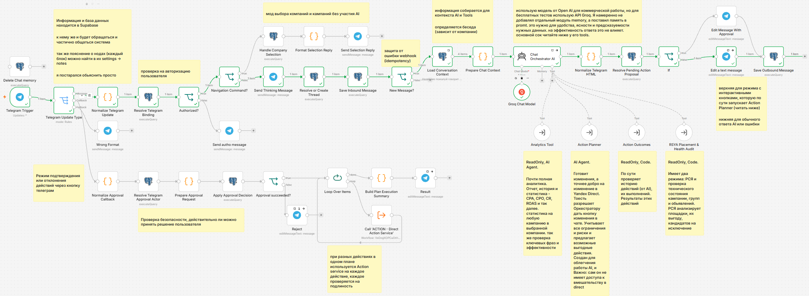
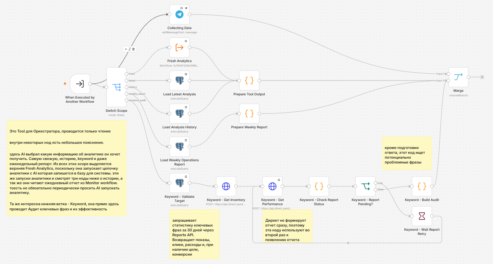
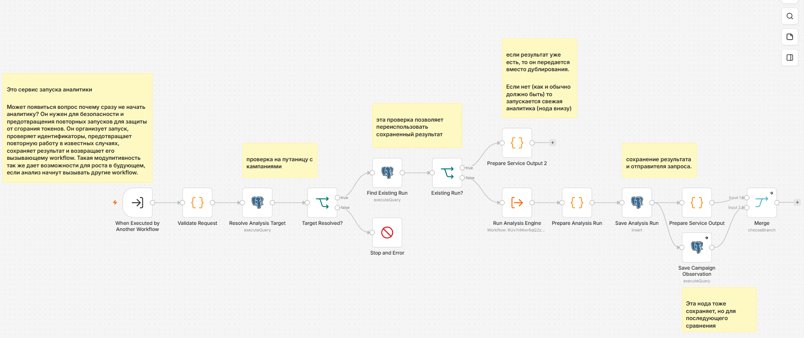
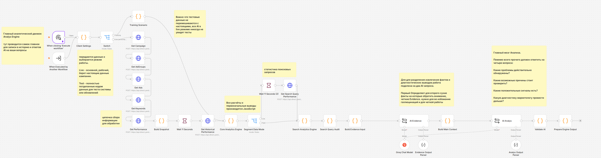
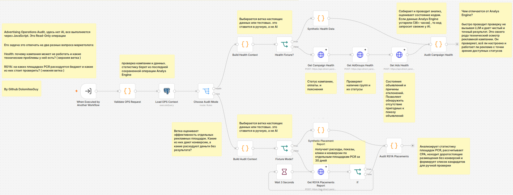
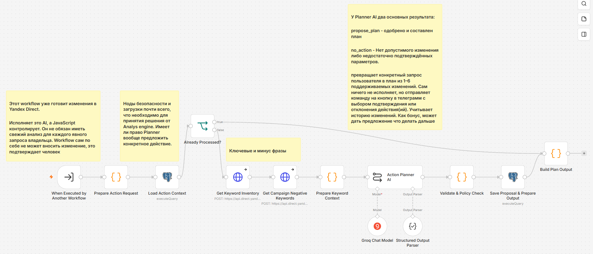
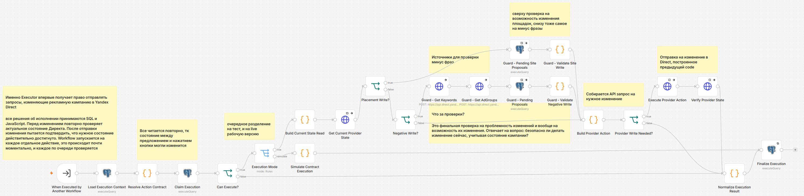
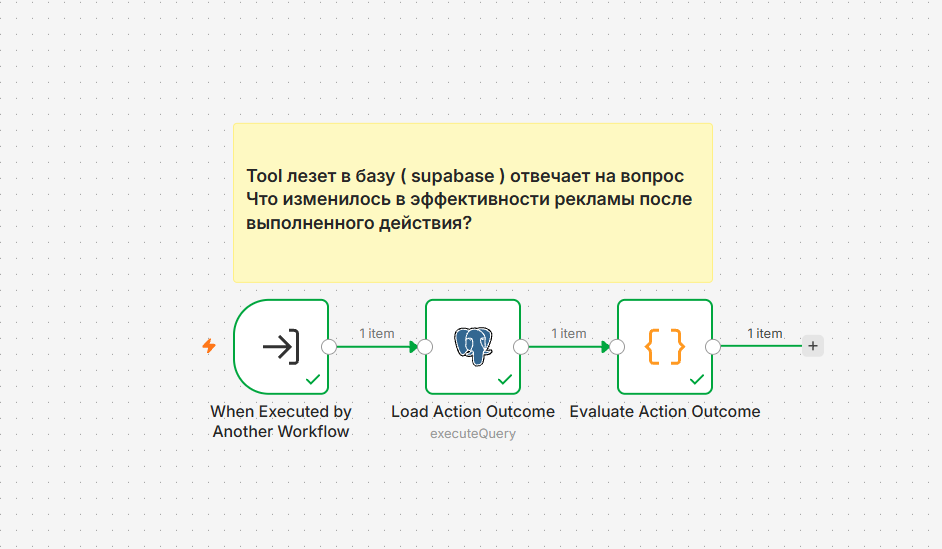
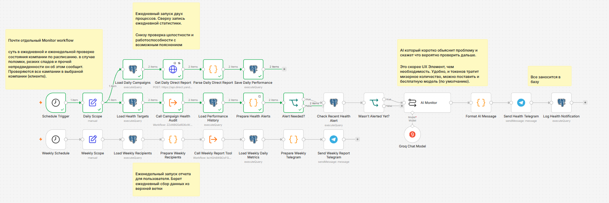

# AI-Marketing-Agent

**AI Marketing Analytics & Direct Operations Agent** - система для аналитики, мониторинга и контролируемого управления рекламными кампаниями в Яндекс Директе

Проект разработан для автоматизации значительной части рутинной работы директолога и маркетолога. Он объединяет сбор статистики, технический аудит рекламы, AI-анализ, подготовку оптимизационных действий и их исполнение через API после подтверждения пользователя

**Tech Stack:** n8n · JavaScript · PostgreSQL / Supabase · Yandex Direct API · Groq · ChatGPT · Telegram Bot API

## Project Overview

https://github.com/user-attachments/assets/5e4def8d-5558-490b-a536-0faf3715668b

---

### Какую проблему решает система?
Управление рекламой в Яндекс Директе требует постоянного контроля. Анализировать статистику, искать неэффективные расходы, отслеживать изменения показателей и принимать решения по оптимизации.
AI Marketing Agent объединяет эти процессы в одной системе.
Главная идея проекта это автоматизировать сбор информации, диагностику и техническое исполнение рутинных операций, оставив окончательное решение об изменении рекламы за человеком.

### Основные возможности

- **AI-ассистент в Telegram.** Пользователь общается с системой, выбирает кампании, запрашивает аналитику и подтверждает внутренние действия
- **Анализ рекламной статистики.** Расчёт CTR, CPC, CPA и других метрик на основе доступных данных Яндекс Директа
- **Диагностика рекламных кампаний.** Поиск технических проблем, отклонённых объявлений, проблем модерации и других сигналов
- **Аудит РСЯ.** Анализ отдельных рекламных площадок, расходов, конверсий и кандидатов на исключение или ручную проверку
- **Аудит ключевых фраз.** Получение статистики по ключевым словам, анализ эффективности и проверка поисковых запросов
- **Планирование изменений.** AI формирует конкретные предложения по оптимизации в пределах поддерживаемых операций
- **Автоматический мониторинг.** Ежедневная проверка кампаний, сохранение статистики и уведомления в телеграм на особые случаи
- **Еженедельные отчёты.** Сводка аналитики и рекламных операций
- **Отслеживание результатов.** Сравнение рекламных показателей до и после подтверждённых изменений
---

## Система состоит из 9 взаимосвязанных workflow

### 01 CHAT: Telegram Orchestrator

Главная точка взаимодействия с пользователем.

- Получает и обрабатывает сообщения из Телеграма
- Идентифицирует пользователя и проверку его доступа
- Выбор компании и рекламной кампании
- Маршрутизацию запросов между инструментами
- Подтверждения и отклонения действий
- Вызов исполнительного сервиса после успешного подтверждения

### 02 TOOL: Campaign Analytics

Инструмент аналитики, доступный Orchestrator и другим модулям в будущем

Поддерживает пять основных сценариев:

- `fresh` — запуск нового анализа (последующие workflow)
- `latest` — получение последнего сохранённого анализа
- `history` — просмотр истории аналитики
- `weekly_report` — еженедельная операционная сводка
- `keyword_audit` — аудит ключевых фраз

### 03 CORE: Analysis Run Service

Промежуточный сервис организации аналитических запусков.

Его задачи:

- Проверить параметры запроса
- Определить правильную компанию и кампанию
- Исключить неоднозначность рекламных объектов
- Найти ранее выполненный подходящий анализ
- Запустить Analysis Engine
- Сохранить результат анализов
Позволяет централизовать запуск аналитики и уменьшить количество повторных запросов, был отделен как отдельный workflow для модульности

### 04 CORE: Analysis Engine

Основной аналитический движок

Получает информацию о рекламной кампании, группах объявлений, объявлениях, ключевых фразах, расходах и результатах рекламы

Внутри выполняются:

- Сбор данных через API
- Расчёт показателей рекламной воронки
- Анализ поисковых запросов
- Подготовка фактов для LLM
- AI-интерпретация и диагностика
- Проверка и структурирование ответа модели

AI получает подготовленный контекст, а его выходной ответ дополнительно проверяется кодом.
Предусмотрены отдельные сценарии работы с синтетическими тестовыми данными.

### 05 OPS: Advertising Operations Audit

Read-only модуль для двух диагностических задач

**Campaign Health:** проверяет состояния кампании, оплаты, групп и объявлений. Помогает обнаруживать причины отсутствия показов и проблемы модерации
**RSYA Placement Audit:** анализирует статистику площадок РСЯ, рассчитывает показатели эффективности, обнаруживает дорогие размещения без конверсий и составляет список кандидатов для проверки

Работает детерминированно, без LLM

### 06 ACTION: Planner

Преобразует пользовательский запрос в структурированное предложение по изменению рекламы.
Использует LLM для подготовки плана, после чего выполняет независимую программную проверку `Validate & Policy Check`.
Planner сохраняет предложение для дальнейшего подтверждения, сам не изменяет рекламу.

### 07 ACTION: Executor

Модуль, отвечающий за фактическое выполнение разрешённых изменений через Yandex Direct API.

Поддерживает 8 операций:

1. Приостановка рекламной кампании
2. Возобновление рекламной кампании
3. Приостановка ключевой фразы
4. Возобновление ключевой фразы
5. Изменение целевого CPA
6. Изменение недельного бюджета
7. Добавление минус-фраз на уровне кампании
8. Добавление исключаемых площадок РСЯ

После одобрения действия Executor повторно проверяет условия выполнения, актуальное состояние объекта и ограничения.
Предусмотрен отдельный режим симуляции

### 08 TOOL: Action Outcomes

Инструмент проверки измеряемых результатов рекламных изменений.
Сравнение показывает изменения показателей, но не доказывает причинно-следственную связь между действием и результатом.
После подтверждённого действия сравнивает 7 полных календарных дней до изменения и 7 после изменения.
Для расчёта требуется достаточный объём ежедневной статистики. Если данные неполные или период ещё не завершён, система сообщает об этом

### 09 MONITOR: Campaign Monitor

Автоматический модуль мониторинга, работающий по расписанию с Ежедневными процессами и еженедельными.
Поддерживается обработка нескольких рекламных кампаний одной компании.
При экстренных или экстренно отличных показателей сообщит об этом в телеграм.

---

## Safety

В проекте реализовано разделение между аналитикой, планированием и изменением рекламы

AI не может самостоятельно выполнить рекламное изменение. Сначала формируется предложение, затем пользователь подтверждает его через телеграм

Система проверяет пользователя, его привязку к компании, разрешения и допустимые операции

Перед сохранением и исполнением предложений выполняются проверки JavaScript и SQL

Executor использует повторную проверку прав, контрактов действий, актуального состояния рекламных объектов и защиту от повторного исполнения

Синтетические данные используются для тестирования аналитических сценариев. Исполнительный workflow также предусматривает безопасную симуляцию

---

## Sample Workflow

Для публичного технического примера я выбрал **OPS — Advertising Operations Audit**
Вы можете скачать файл ниже (JSON code) для осмотра этого workflow в ручную.
Нужно перекинуть файл или просто скопированный код в n8n и вас будет ждать готовые pin test даты для успешной работы.

[View OPS Source Code](OPS-workflow-download)

В нём можно изучить обработку данных, логику технического аудита, расчёт показателей РСЯ и сценарии тестирования

Полная конфигурация базы данных и остального не входит в публичную версию

## Code

Полная реализация проекта, SQL-схема, системные настройки и конфигурация интеграций хранятся в приватном репозитории.
Большую часть JavaScript и SQL я сгенерировал в нейросети для эффективной работы.

Публичная версия предназначена для знакомства с архитектурой, изучения отдельных технических решений и проверки демонстрационного workflow.

---

на этом все, хорошего вам дня
